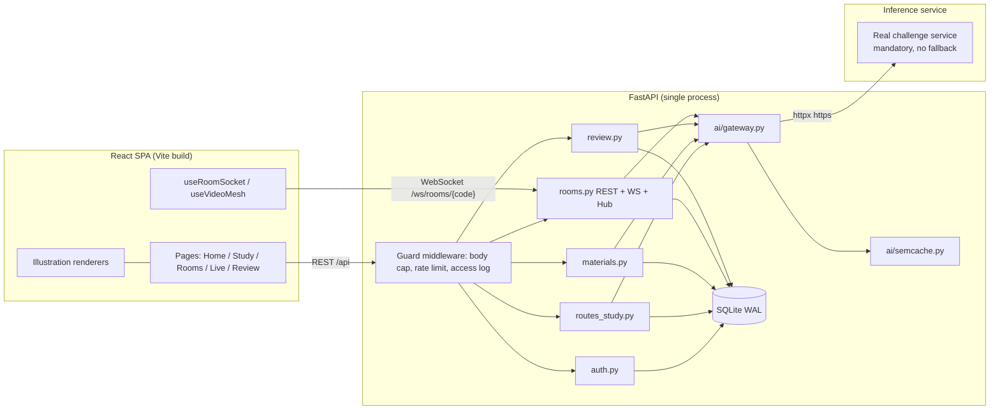

# HerwieGO — Project Technical Documentation & Development Handover

> Generated 2026-11-08 by inspecting the actual repository (`herwiego/`). Grounded in source, not in conversation.
> Companion files in `docs/handover/`: `PROJECT_HANDOVER_PROMPT.md`, `DEVELOPMENT_ROADMAP.md`, `env.example.txt`, `PROJECT_STRUCTURE.txt`.
> Verified: `python -m pytest -q` → **143 passed**; `npm run i18n:check` → **all translations present (495 sentences)**; `npm run attention:test` → **9 passed**; `npm run qr:test` → **4 passed**; `npm run build` → OK; Playwright suites `run.py`, `game.py`, `camera.py`, `resume.py`, `lang.py`, `attention.py`, `forest.py`, `draw.py` → PASS (not re-run for the Lot 3e pocket-tree addition below — see its own backend tests instead).

---

## 1. Project overview

**HerwieGO — GenAI Peer Learning Companion.** A web learning platform built for the **IEEE WIE ACT 5.0** challenge (Phase 1 deliverables: report ≤6 pages, business-model note, GitHub repo, demo — deadline **10 November 2026**). The report and business-model note are intentionally deferred by the project owner.

**Purpose.** Give a learner an AI tutor whose every explanation comes with an **interactive illustration beside the text**, plus tools to practice (quizzes, hints, spaced-repetition flashcards, a revision sheet) and to study socially (study rooms of 2–10, and public "Live" focus rooms with a shared pomodoro timer, cameras, chat and break games).

**Target users.** Students (secondary/university). Accounts are **pseudonymous** (a pseudo + password, no email).

**Problems it addresses.** Passive text-only tutoring; studying alone/unmotivated; forgetting (spaced repetition); the cost/latency/quota of large models (handled by a routing + caching gateway).

**Core functionalities.**
- Solo study: **study spaces** — several solo rooms per learner, each with its own course material and conversation memory; a staged tutor (intent → sources → quick draft → final answer → figure, each pushed to the screen the moment it is ready) + 3-level hint ladder + self-quiz. Optional declared Wikipedia lookup.
- Learning-style diagnostic that tunes the explanation style (backend only since 10 Nov: the quiz was removed from the UI, so solo study opens straight on the tutor; a style set earlier still applies).
- RAG: upload PDFs/images/text as course material; answers can be grounded in it.
- Revision: quizzes become SM-2 flashcards; a student-triggered **revision sheet** recaps studied topics.
- Study rooms (2–10): shared explanation/quiz, chat, saved as a conversation with an AI summary.
- Live public rooms: shared pomodoro clock, presence + focus signal, reactions, **camera wall (WebRTC mesh)**, **live chat**, **private messages**, and **break games** (Quiz / Mime / Pictionary) with **per-player choice and parallel play**.
- Multilingual UI: English, French, Arabic, Darija (with RTL).

**Architecture approach.** React/Vite SPA ⇄ FastAPI (REST + WebSocket) ⇄ an **AI gateway** that is the only component talking to the inference service. A built-in **fake inference service** (OpenAI-compatible) runs in-process so the whole app works end-to-end with no external key; switching to the real service is a `.env` change. Single-process by design (SQLite, in-memory room state).

---

## 2. Complete technology stack

### Frontend
- **Framework:** React 18.3 (`react`, `react-dom`). Language: modern JS/JSX (ES modules).
- **Build tool / dev server:** Vite 5.4 (`@vitejs/plugin-react`). Dev server proxies `/api` and `/ws` to `:8000` (`vite.config.js`).
- **Routing:** `react-router-dom` 6.26 (`src/App.jsx`).
- **State management:** React hooks + a small Auth context (`src/lib/auth.jsx`); no Redux. Custom hooks in `src/lib/hooks.js`.
- **API communication:** `fetch` wrapper with bearer token (`src/lib/api.js`); WebSocket for rooms.
- **Styling:** a single hand-written `src/styles.css` with design tokens (no Tailwind/MUI). **Purple theme since 10 Nov:** Primary `#6839F5`, Secondary `#29145E`, Tertiary `#8057FF`, Neutral `#1E1738`; dark gradient header with pill nav, gradient `.page-head` banners, soft white cards. The theme is a token remap plus a "Purple theme layer" block at the end of `styles.css` (no class names changed). Fonts via `@fontsource/*`: Manrope (headings/body) and JetBrains Mono (labels), Latin subsets only; Noto Kufi/Naskh Arabic for RTL. `components/Backdrop.jsx` draws the interactive background (canvas: drifting orbs, a node constellation that links to the pointer, click ripples; pointer-events none, paused when the tab is hidden, a still frame under reduced motion; not shown on the standalone `/tree/:token` page).
- **i18n:** custom `t()/tx()/tr()` (`src/lib/i18n.jsx`) + English-keyed dicts in `src/locales/{fr,ar,darija}.js`. `scripts/i18n-check.mjs` enforces coverage (build fails on missing OR unused keys).
- **Illustrations:** in-house SVG renderers in `src/visuals/` (no chart lib).
- **On-device face model (opt-in attention check):** `@vladmandic/human` 3.3.6 (MIT), loaded lazily by dynamic `import()` only when the learner opts in (separate ~1.6 MB chunk). Only BlazeFace + FaceMesh are used; their weights (~2 MB) are self-hosted in `frontend/public/models/` so no third-party download happens.
- **QR code (study forest invite):** `qrcode-generator` ^1 (MIT, no dependencies). Only its boolean module matrix is used (`frontend/src/lib/qr.js`); `components/QrCode.jsx` draws it as inline SVG (no canvas, no image, CSP-safe), always dark on white with a 4-module quiet zone. `jsqr` (dev only) decodes it in `npm run qr:test`.

### Backend
- **Framework:** FastAPI ~0.162 on **uvicorn[standard]** ~0.54. Language: **Python 3.11+** (CI runs 3.12 and 3.13; Docker uses 3.13).
- **API architecture:** REST under `/api/*` + a WebSocket at `/ws/rooms/{code}`. Routers split by domain (`auth`, `routes_study`, `materials`, `rooms`, `review`).
- **Auth/authorization:** scrypt password hashing; **HMAC-SHA256-signed bearer token** (stateless, `app/auth.py`). No external IdP.
- **Business logic:** `app/ai/pipeline.py` (study steps), `app/rooms.py` (rooms/games), `app/materials.py` (RAG), `app/review.py` (SM-2).
- **Middleware:** custom `security.Guard` (body-size cap, rate limiting, access log with secret redaction).
- **Background services:** asyncio tasks — document indexing (resumed on startup via lifespan), turn-game drivers, presence scheduling.
- **HTTP client:** `httpx` (gateway → the real inference service over real HTTP; no mock transport in the shipped app — tests inject a test-only `httpx.MockTransport` via `create_app(ai_transport=...)`).
- **PDF:** `pypdf` (text extraction for RAG).

### Database & storage
- **Engine:** **SQLite** (WAL mode), file at `HERWIEGO_DB` (default `herwiego.db`; Docker `/data/herwiego.db`).
- **Client/ORM:** none — a thin hand-written wrapper `app/db.py` (parameterised SQL, a global lock, `row_factory=Row`). Schema created on boot via `executescript`; two lightweight in-code migrations (`ALTER TABLE` for `docs.kind`, `rooms.summary/summary_at`).
- **File storage:** uploaded images/PDFs stored **as BLOBs in SQLite** (`blobs` table), served via `/api/materials/{id}/raw`. No external object store.
- **Vectors (Lot 14, simplified Lot 15):** `HERWIEGO_VECTOR_BACKEND=local` is the default and supported setup: vectors live in `chunks.emb` in the app's SQLite database and search is cosine in Python, one library per scope (study space `s:<id>`/`u:<uid>`, room `r:<code>`). At the owner's direction ("there is no platform vector database") the Qdrant/Chroma adapters in `app/vectors.py` are kept dormant and are not part of the run setup. Without any embeddings endpoint, ranking is keyword relevance alone.
- **Embedding cache (Lot 14):** `emb_cache(key = sha1(embed model + passage text), emb)` — a passage is never sent twice to the separately metered embeddings endpoint, even across libraries or restarts (`embed_cache_hits` metric). Query embeddings are cached in memory by the gateway.

### External services & integrations
- **AI/LLM:** an OpenAI-compatible inference service (the challenge service), real credentials mandatory — **no built-in fake/mock service and no fallback** (removed 10 Nov; `HERWIEGO_BASE_URL`/`HERWIEGO_API_KEY` must be set to a real, working endpoint or the app refuses to start). The backend test suite uses its own test-only fake HTTP transport (`backend/tests/_fake_service.py`), which is not reachable from the running app. Three model classes: **compact** (classification/triage, field extraction/formatting, short targeted summaries, fallback — `route`, `filter`, `answer`, `hint`, `quiz_check`, `summary`), **mid-size** (reasoning/synthesis/planning + final user-facing writing — `illustrate`, `explain`, `quiz`, `resume`), **embeddings** (RAG + semantic cache). Study-space tutor steps: `intent`, `draft`, `memory` = compact; `tutor` (final answer), `illustrate` = mid.
- **Wikipedia (declared external source, Lot 13):** `app/ai/web.py`, keyless MediaWiki API (`action=query&generator=search&prop=extracts`), 3.5 s timeout, cached 6 h, User-Agent identifies the project. Used by the study-space tutor only when the space's material has no relevant passage or the question asks for reference facts; never for small talk; never when the question looks like it contains personal details; switchable per message (UI) and globally (`HERWIEGO_WEB_SEARCH=0`). Every answer that used it shows "Wikipedia" sources with links (CC BY-SA attribution).
- **Auth providers / email / payments:** none.
- **WebRTC:** peer-to-peer camera/mic mesh; signalling relayed through the app's WebSocket. No TURN/STUN configured (works on LAN/same-NAT; see limits).

---

## 3. Project file structure

See `PROJECT_STRUCTURE.txt` for the full annotated tree. Key points:

- **Entry point:** `backend/app/main.py` → `create_app()` builds everything; module-level `app = create_app()` is what `uvicorn app.main:app` imports. It also **serves the built SPA** (`frontend/dist`) when present, so one process can host the whole app.
- **Config:** `backend/app/config.py` — a frozen `Settings` dataclass; `load_settings()` reads env (auto-loads `backend/.env`). Nothing environment-specific is hard-coded.
- **Routers (backend/app/):** `auth.py`, `routes_study.py`, `materials.py`, `rooms.py`, `review.py`. There is **no separate controller/service/model layer** — each router file holds its routes + logic; cross-cutting helpers live in `security.py`, `i18n.py`, `db.py`.
- **AI subsystem (backend/app/ai/):** `gateway.py` (the only caller of the service — always talks to the real endpoint, no mock mode), `pipeline.py` (study steps + JSON validation), `prompts.py` (prompt builders + schemas + few-shot), `visuals.py` (figure validation; six templates including the 10 Nov additions `timeline`/`comparison`), `semcache.py` (semantic cache). `mock_api.py`/`mock_llm.py` were deleted 10 Nov; the test-only replacement lives at `backend/tests/_fake_service.py`, outside the shipped `app/` package.
- **Frontend pages (frontend/src/pages/):** `Home`, `Study` (solo tutor), `Rooms` (lobby), `Room` (study room), `Live` (lobby) + `LiveRoom` (camera wall + room forest + study notepad), `Review`, `PhoneTree` (standalone `/tree/:token` pocket-tree page, no app header/nav — see §7's Pocket tree row).
- **Frontend libs:** `lib/hooks.js` holds the hard parts — `useRoomSocket`, `useCycle` (epoch-aligned pomodoro), `useVideoMesh` (WebRTC perfect-negotiation), `useFocusSignal`, `useAIStatus`.
- **Illustration renderers:** `src/visuals/*` one per template, dispatched by `VisualSheet.jsx`.
- **Tests:** `backend/tests/` (pytest, 233 tests in 21 files) and `e2e/` (Playwright, run against a live server).

---

## 4. System architecture & data flow



**Frontend/backend communication.** REST for everything stateless (bearer token in `Authorization`); a single WebSocket per room for real-time (presence, chat, DM, reactions, timer, games, WebRTC signalling). Media (camera/mic) is peer-to-peer; only signalling passes through the server.

**Auth flow.** `POST /api/auth/register|login` → scrypt-verify → return an HMAC-signed token (`<body>.<sig>`). Client stores it in `localStorage` and sends `Authorization: Bearer <token>`. `current_user()` verifies the signature and loads the user. The WebSocket passes the token in the query string (so the server's own access log is disabled; the app writes a redacted log instead).

**AI request flow (example: explain).** `POST /api/study/explain` → `security.spend_ai()` (per-user rate limit) → optional RAG retrieval from the learner's material → `pipeline.explain()` → `gateway.chat()`:
1. exact cache → semantic cache (`semcache`) → in-flight merge (dedupe concurrent identical calls);
2. route to **mid** (figure) and **compact** (text) as the step requires;
3. concurrency cap, retries, **quota wait** (429/Retry-After up to `max_quota_wait_s`, else a friendly error), **503→compact fallback**;
4. schema-aware JSON validation/repair (`pipeline` + `visuals`).
Then `log_event()` records it in `events` for progress/revision.

**RAG workflow (Lot 14).** Upload → personal-data guard → paragraph-aware chunks of ≤ 800 chars with one sentence of overlap → embeddings in batches of 32 through the content cache → platform vector index (+ local mirror). Question → standalone rewrite (intent step) → query embedding (cached) → vector search for 3k candidates in the library's scope (platform index, else mirror) ∪ the top keyword matches → **hybrid score** 0.8 × cosine + 0.2 × keyword relevance (Lot 15: ½ normalised BM25 + ½ term coverage, EN/FR/AR stopwords removed; exact terms such as names, formulas and symbols still count) → top k → **neighbouring chunks of one document merged** (no repeated overlap sentence) → **adaptive cut** (Lot 15): keep passages with score ≥ max(`min_similarity`, 0.5 × best score) → the compact draft cites the ones that answer → **only the cited passages (+ the best material passage, max 3) reach the mid-size call** (narrow-before-generating; a shorter prompt is also a faster CPU answer). Room material Q&A keeps its compact filter when more than 3 passages match.

**Study-space tutor flow (Lot 13, `POST /api/spaces/{id}/ask`, Server-Sent Events).** The inference service answers each request whole (guide: no streaming; "staged feedback or partial results"), so the turn is split into stages and each finished stage is pushed to the browser (`StreamingResponse`, `text/event-stream`; the browser reads it with `fetch` + a stream reader, `lib/api.js streamPost`). `ai/tutor.py run_turn`:
1. `stage:understanding` → **intent** (compact, JSON): intent (`explain|question|follow_up|practice|chat`), a **standalone** rewrite of the message that resolves references from the conversation ("why?", "the second step"), topic, level, `needs_web`, `figure`. Fails soft to a default intent.
2. `stage:reading` → retrieval over **this space's** collection with the standalone question (embeddings or keyword fallback), and — started in parallel, speculatively — the Wikipedia lookup; web results are used only if the material has nothing relevant or `needs_web`. → `sources` event (material first, then web; one numbering for citations).
3. **figure** task started now (mid, `illustrate`, grounded in the material passages) in parallel with the writing; skipped for chat/practice.
4. `stage:drafting` → **draft** (compact, ≤ 90 words) → `draft` event: first visible text within seconds.
5. `stage:writing` → **tutor** (mid): corrects and completes the draft from the sources (draft-then-revise) → `final` event. If the mid call fails, the draft is kept (`draft_kept`), never an empty screen.
6. `stage:illustrating` (if still running) → `visual` event (concept-map fallback built from the answer's numbered steps when no figure spec is usable) → `done` (message id, calls, ms).
Chat/greetings: one compact reply, no mid call. The user message is stored before generation, the assistant message (with sources, figure, intent, calls in `meta`) after `done`; then a background **memory fold** (compact) merges messages older than the window into `spaces.summary`. Every turn sends `spaces.summary` + the last `HERWIEGO_MEMORY_WINDOW` messages. Measured against a stand-in service with CPU-like delays (intent 1 s, draft 2 s, tutor 4.5 s, figure 6.5 s): first text at 3.0 s, final at 7.5 s, figure at 7.5 s — the previous `explain` pipeline showed nothing until about 11 s. Gateway metrics now report `first_text_ms_median` and `final_text_ms_median`.

**Study-room explanation (Lot 14).** `run_explain` uses the same staged tutor with the intent known (the room topic), so it costs 1 compact (draft) + 2 mid-size (final, figure) and every member receives the same `tutor` events over the room WebSocket (sources → draft → final → figure), then `explanation` with the final shape `{text, sources, used, visual, visual_fallback, figure_note, intent, meta}` (kept in the snapshot for late joiners). A topic change mid-generation drops the old explanation. **Live-room notepad Assistant (Lot 14)** = the staged tutor of the learner's first study space (`components/SpaceTutor.jsx`, `compact` layout): same conversation, memory and material as Solo study.

**Live-room game flow (per-player, parallel).** During focus, each client sends `event_optin{game}`; a player belongs to exactly one game. On the break, each chosen game runs in parallel: **trivia** is clock-driven (clients derive the question schedule; server scores `game_result`), **mime/pictionary** are driven by a short server task (`run_turn_game`) per game. Game messages are **scoped to that game's players** (`broadcast_game`). The choice resets each break.

---

**Lot 15 additions (10 Nov).**
- **Document analysis, once per document.** After indexing, `materials.summarise_document` runs one compact call (`TASK: doc_summary`) on passages sampled across the whole document (`_sample`, ≤ 3600 chars) and stores `{summary, key_terms}` in `docs.summary`. `library_overview(db, collection)` gives the tutor the analysed documents of a library; `tutor.run_turn(library=...)` passes the ones matching the material sources (else the 3 newest) to the intent, draft and final prompts. Never repeated for a document.
- **Room "ask the material" box = the staged tutor.** `rooms.run_ask` calls `tutor.run_turn(figures=False, use_web=False)` with the last 2 room answers as conversation context; members receive `tutor_ask` events (sources → draft → final) and then `answer {question, asker, text, sources, used, grounded, meta}` (kept in `qa_log`). Personal-data guard before anything is sent; questions up to 500 chars.
- **Step → figure links.** `visuals.step_focus(steps, visual)` maps each numbered step of the final answer to a figure part (Thales: the segment/triangle named first; process/timeline/comparison/concept map: the label sharing the most words). Sent as `step_focus` with the `visual` event and in `done`; the `Answer` component makes linked steps selectable and passes the key as `focus` to `VisualSheet`. No AI call.
- **Room competition** (`app/competition.py`, WS `comp_start`/`comp_answer`/`comp_stop`): one mid call writes 8 grounded questions (mcq, truefalse, numeric, exercise, short; compact review if `quiz_verify`), the server keeps the clock (`TIME_S`), scores closeness × (500 + 500 × speed) (+100 to the closest numeric answer), reveals after everyone answered or time is up (`REVEAL_S` 6 s), ends on a podium, saves a `competitions` row and awards account points (3 + 2 per right answer + podium 10/6/3, social cap 40/day). `quiz_start` is blocked while a competition runs; `comp_start` goes through the AI budget guard.
- **Scoring v2** (`app/scoring.py`, `SCORING_VERSION = 2`): `study_time(user_id, day, context, minutes)` fed by `POST /api/score/heartbeat {context: solo|live|room}` (≤ 1 minute per 55 s per user and context; the browser's `useStudyClock` only beats while the learner is active). Effective minutes = solo + live focus + 0.6 × room + 2 × productive actions; ≥ 25 → working day (+20) and working-day streak (+5 × min(S, 10)). Rule kinds: productive / rhythm / social (social capped low). `week_report` → today meter, 7-day bars, productivity index.
- **Generation survives leaving the page (Lot 15 follow-up).** `spaces.ask` inserts the user message and an assistant placeholder (`meta = {"pending": true, "events": [...]}`), then runs `spaces._run` as a server task (`Turn`: event list + `asyncio.Condition`; `app.state.space_turns[space_id]`). The SSE response only *subscribes* (`Turn.stream` replays every event, then follows), so a closed page stops listening, not generating. Progress is saved on draft/final/visual (≤ every 0.5 s otherwise); the final row replaces it. `GET /api/spaces/{id}/turn` reconnects (204 when idle), `DELETE` stops (row → `stopped`, partial text kept), a second ask while running → 409. At start `recover_interrupted` turns leftover `pending` rows into `interrupted` with their partial text. Frontend `SpaceTutor.follow()` + `Unfinished` (shows partial answer + "Ask again"). Rooms: `Room.save()` writes `{topic, explanation, quiz, results, qa}` to `rooms.state` (restored in `Room.__init__` when the topic matches); `live_explain` / `live_ask` hold the events of the generation in progress and are sent in the `snapshot`, so a returning member replays them (`Room.jsx` reduces them with `liveStep`).
- **Voice** (`lib/voice.js`, `components/Voice.jsx`): dictation through the Web Speech API after an explicit consent (on-device `processLocally` requested when available), read-aloud with `speechSynthesis`. `Permissions-Policy: microphone=(self)`.
- **Phone icon / PWA:** `public/apple-touch-icon.png` (180), `icon-192.png`, `icon-512.png`, `icon-maskable-512.png`, `manifest.webmanifest`, linked from `index.html`.
- **PDFs always load (Lot 15 fix).** `materials.pdf_pages` (pypdf, tolerant to damaged pages and empty-password encryption) → `page_needs_ocr` (< 40 chars, or > 5 % `\ufffd`/`(cid:` codes, or < 30 % letters) → if any page needs it, the doc is created with status `reading` and `ocr_document` renders those pages with pypdfium2 (greyscale JPEG ≈ 144 dpi, ≤ 2000 px, blank pages skipped) and sends each to `gateway.ocr` (`HERWIEGO_OCR_MODEL`, default `deepseek-ocr`, OpenAI-style `image_url` data URI + "Free OCR.", max_tokens 1024, counted in `ocr_calls`, not in the compact/mid split; `app.state.ocr_lock` = one document at a time; resumed at start). Then redaction → chunks → `index_document`. Nothing readable → status `file` (kept, openable). Personal details in material are **redacted** (`redact_personal`: e-mails, international phones, 9+ digit numbers) instead of refused; `docs.note` JSON `{ocr_pages, ocr_failed, removed}` is shown in the library. PDF upload cap 20 MB (`HERWIEGO_MAX_PDF_MB`; the Guard middleware allows it on `/api/materials/file` only). New deps: `pypdfium2`, `pillow`. Check with the real key: `python scripts/check_ocr.py file.pdf`.
- **Answer quality (after the first real-key session).** `prompts.EDUCATOR` + `ANSWER_SHAPES["explain"]` (## title, summary, ### Key ideas numbered with bold concepts, ### How they connect, ### Example, ### Check yourself) + accuracy rules (verify against sources, final writer distrusts the draft, no mixed models, no invented numbers); `DRAFT_SHAPES`; `tutor.clean_answer` strips wrappers/"Sources:"/figure notes/placeholders. Figure: started **after** the final text, `illustrate_messages(answer=final, library=…)` must mirror the answer's items/order/count; `_validate_figure` raises on an unusable spec → schema-aware repair with exact param shapes (`FIGURE_SCHEMA`); `visuals.sanitize_visual` accepts aliases (`TEMPLATE_ALIASES`, `LIST_KEYS`, `LABEL_KEYS`, `DETAIL_KEYS`, top-level params); `tutor.figure_from_text` falls back to numbered items → bullets → bold terms → document concepts. `MID_SOURCES` 4. Hints: `HINT_LEVELS` prompt + `pipeline.plain_text`. Documents: `doc_summary` on **mid** (once), shape `{subject, summary, concepts:[{name, simple}], links:[{from,to,label}]}`, older summaries re-analysed once at start; `materials.looks_front_matter` → ×0.35 in retrieval and skipped by `_sample`.
- **Image lightbox** is rendered in a portal on `document.body` (a transformed panel was trapping its fixed overlay) and closes with Escape.

## 5. Complete feature inventory

| Feature | Description | Location | Status | Dependencies |
|---|---|---|---|---|
| Pseudonymous auth | register/login/me; scrypt + HMAC token | `app/auth.py`, FE `lib/auth.jsx` | FULLY IMPLEMENTED | `users` table, `HERWIEGO_SECRET` |
| Learning-style diagnostic | 4-question quiz sets `users.learning_style` | `routes_study.py` (`/study/diagnostic`) | BACKEND ONLY — UI quiz removed 10 Nov at the owner's request; endpoints kept, an existing style still applies | users |
| Solo explain + figure | explanation (compact) + illustration spec (mid) rendered as SVG | `pipeline.explain`, `ai/visuals.py`, FE `pages/Study.jsx`, `visuals/*` | FULLY IMPLEMENTED | gateway, events |
| Hint ladder (3 levels) | progressive hints | `/study/hint`, FE `HintLadder` | FULLY IMPLEMENTED | gateway |
| Self-quiz (+answer/finish) | compact draft + compact review; answer check; finish logs score | `/study/quiz*`, FE `SoloQuiz` | FULLY IMPLEMENTED | gateway, events |
| Progress panel | topics, mastery, streak | `/progress`, FE `ProgressPanel` | FULLY IMPLEMENTED | events |
| Revision sheet (student-triggered) | per-topic recap from recent `events` (compact) | `/study/resume`, `pipeline.revision_sheet`, FE `pages/Study.jsx` RevisionSheet | FULLY IMPLEMENTED (tests + E2E `resume.py`) | events, gateway |
| Spaced repetition (SM-2) | quizzes → flashcards; grade/due/stats | `app/review.py`, FE `pages/Review.jsx` | FULLY IMPLEMENTED | `cards` table |
| RAG materials | upload PDF/image/text, background index, similarity search (keyword fallback if no embeddings) | `app/materials.py`, FE `components/Materials.jsx` | FULLY IMPLEMENTED | `docs`/`chunks`/`blobs`, embeddings (optional) |
| Grounded answers | answer strictly from material; personal-data guard | `/materials/ask`, `pipeline.ask_material` | FULLY IMPLEMENTED | embeddings or keyword fallback |
| Study rooms (2–10) | shared explain/quiz, chat (anon option), saved conversation + AI summary | `app/rooms.py` (kind=group), FE `pages/Room.jsx` | FULLY IMPLEMENTED | rooms, room_messages |
| Live rooms: pomodoro + presence + focus signal | epoch-aligned clock; focus computed on device (no camera) | `rooms.py`, FE `useCycle`, `useFocusSignal` | FULLY IMPLEMENTED | — |
| Live camera wall | opt-in WebRTC mesh (video + performer audio), cap `video_capacity` | `rooms.py` (rtc_*), FE `useVideoMesh` | FULLY IMPLEMENTED (E2E `camera.py`) | WebRTC; no TURN |
| Live chat | room-wide text chat | `rooms.py` live branch `chat`, FE `RoomChat` | FULLY IMPLEMENTED (test + run.py) | — |
| Private messages | DM to one named member (sender+recipient only) | `rooms.py` `dm`, FE `RoomChat` selector | FULLY IMPLEMENTED (test) | — |
| Account score + tracking | every user's actions tracked (`activity`); points ledger with rules + daily caps, levels, ranks, weekly/all-time leaderboard; shown on Home (`ScorePanel`); test DB generator | `app/scoring.py`, `scripts/test_db.py`, FE `components/Study.jsx` `ScorePanel` | FULLY IMPLEMENTED (pytest `test_scoring.py` 7) | auth, study, games |
| Break games: per-player choice + parallel | each player picks Quiz/Mime/Pictionary; same-game players play together; reset each break | `rooms.py` events model, FE `pages/Live.jsx` | FULLY IMPLEMENTED (tests + E2E `game.py`) | — |
| Game: Quiz (trivia race) + break trivia | clock-driven MCQ (25 s per question); **questions are fresh every break**: written by the compact model (task `trivia`) in the languages of the people in the room, else sampled from a 22-question built-in bank in EN/FR/AR/Darija (options shuffled); the server holds the answers and scores the pick | `app/games.py` (`make_trivia`, `TRIVIA_FALLBACK`), `rooms.py` (`ensure_content`, `game_content`, `game_result`), FE `GroupGame`, `BreakGame` | FULLY IMPLEMENTED (pytest `test_games.py`) | compact model (optional) |
| Game: Mime | turn-based on the camera wall. Everyone gets a **private word up front** and sees the **full order** ("you play right after X"); turn = **60 s in long-break rooms (break ≥ 10 min, e.g. 50/10), else 30 s with 20 s of prep before the first turn**; a turn ends on time, when the performer **passes**, or when **every other player has guessed**. **The server judges chat guesses**: exact (any language, articles ignored) → hidden, scored (+100…150 guesser, +40 performer), announced; **close (≤ 2 characters off, ≤ 1 for short words) → blurred for everyone else + "Close answer!" to the guesser**. Words: compact model (task `game_words`) or a 22-word built-in bank. **Played in rounds until the break ends**: each round every player plays once in a fresh random order (`game_round`; never opening with whoever just played), with a new word each time; a turn is cut to what is left of the break and none starts with under `MIN_TURN_S` (8 s) left. **No two players ever hold the same word**, and no word comes back in a game (`take_word`). **Word swap**: a player can change a hard word up to `MAX_SWAPS` (3) times per round (`word_swap` → `game_word` / `game_swap_denied`), on their own turn only until someone guesses. **While the game runs it takes the middle of the room** (`GameStage`): the performer's camera (mime) or the live board (pictionary) beside the chat; the camera wall comes back at game over. Mime players join the WebRTC mesh **watch-only** (`rtc_join {watch:true}`) so they see the performer without turning their own camera on | `app/games.py` (`judge`, `make_words`, `WORDS_FALLBACK`), `rooms.py` (`turn_timing`, `break_left`, `run_turn_game`, `take_word`, `handle_word_swap`, `judge_chat`, `handle_turn_pass`), FE `GameStage`, `useVideoMesh.watch` | FULLY IMPLEMENTED (pytest `test_games.py` 26; E2E `game.py` 10/10) | camera, chat |
| Game: Pictionary | same engine as mime, drawn on a shared canvas. While waiting, each player sketches their word on a **private practice board** (never sent); when their turn starts the sketch is replayed to the room and they keep drawing live. Swapping the word mid-turn clears the board | same as mime + `components/DrawBoard.jsx` | FULLY IMPLEMENTED (pytest `test_games.py`, `test_draw.py`; E2E `draw.py` 15/15) | chat |
| AI status / metrics | model-usage banner, metrics endpoint | `/ai/status`,`/ai/metrics`, FE `AIStatus` | FULLY IMPLEMENTED | gateway |
| i18n EN/FR/AR/Darija + RTL | enforced coverage | `i18n.py`, FE `lib/i18n.jsx`, `locales/*` | FULLY IMPLEMENTED | — |
| Semantic cache / draft-then-revise | reuse near-duplicate requests; review quiz before display | `ai/semcache.py`, `pipeline.get_quiz` | FULLY IMPLEMENTED | embeddings |
| Real inference service, no fallback | mock/fake service removed 10 Nov; `HERWIEGO_BASE_URL`/`HERWIEGO_API_KEY` mandatory via `.env` or app refuses to start | `ai/gateway.py`, `ai/config.py` | IMPLEMENTED; NOT YET VERIFIED against a working real endpoint (owner had not checked key status as of 10 Nov) | org key/URL |
| Illustration templates: timeline, comparison | two new figure templates beyond the original four, for history/sequence and side-by-side topics | `ai/visuals.py`, FE `visuals/Timeline.jsx`, `visuals/Comparison.jsx` | FULLY IMPLEMENTED (pytest `test_visuals.py`, 8 tests) | gateway |
| Karaoke | — | — | REMOVED (replaced by Pictionary; copyright on lyrics) | — |
| Camera focus/attention detector | opt-in, on-device: face found + head pose → "facing the screen" yes/no, feeds the existing focus boolean; camera released outside focus phase; off by default | `frontend/src/lib/attention.js`, `useAttention` + `useFocusSignal(enabled, camera)` in `lib/hooks.js`, `AttentionCheck` in `pages/Live.jsx`, models in `frontend/public/models/` | FULLY IMPLEMENTED (unit tests `scripts/attention-test.mjs`, E2E `attention.py`) | getUserMedia, `@vladmandic/human` |
| ~~Study forest room + QR code~~ | **REMOVED 10 Nov** — replaced by a forest in *every* live room (next row). The `LIVE-FOREST` room, `/forest` page and E2E `forest.py` are gone (`/forest/*` redirects to `/live`); the desktop `Tree` logic in `rooms.py` (`forest_join`) is kept but no longer used by the UI | — | REMOVED | — |
| Pocket tree = each live room's forest (anti-phone-distraction) | Every live room has its own forest. One QR per member (minted by `GET /api/rooms/{code}/phone-tree`, signed, anonymous) opens `/tree/:token` on the phone; the tree grows while that page is in front and withers after 60 s away (`PHONE_TREE_GRACE_S`). It follows the room's shared clock: **during breaks it is paused** (phone is free; grace restarts at focus). The phone page shows the room and a live "break in …" countdown; on leaving it during focus it speaks + puts in the tab title + vibrates one of several nudges, e.g. "Don't let your focus wither like a tree — the break is in {time} in {room}." The room sees everyone's tree live (`phone_trees` broadcasts + `pocket_trees` in the live snapshot), tree icons on the camera-wall seats, and grown/withered counts; the owner's desktop gets `phone_tree_alert` when theirs withers. The room panel has only that QR + a "Copy invite link" button (room URL) | BE `app/phonetree.py` (`_phase`, `_in_break`, `_view`, `room_pocket_trees`, `_announce`, `_advance(paused=)`, `_watch`); FE `components/RoomForest.jsx`, `pages/PhoneTree.jsx`, seats in `pages/Live.jsx` | FULLY IMPLEMENTED (pytest `test_phonetree.py`, 16 tests incl. break pause, room-aware view, per-room forest list, end-to-end wither→forest→alert) | none |
| Live room: camera wall + study notepad | the room is built around a camera wall showing every member (video if shared, otherwise an avatar seat with focus dot + pocket-tree icon; "camera on — turn yours on to see it" when only they share); timer/focus/attention + room forest on the left; a study notepad on the right with tabs Assistant (ask my material, RAG with citations + my material), My rooms (study rooms I created/spoke in: summary + latest AI explanations, `GET /api/rooms/mine`), Revision (revision sheet), Notes (private, autosaved in this browser) | FE `pages/Live.jsx` (`Stage`, `Seat`), `components/Notepad.jsx`; BE `rooms.py` (`my_rooms`, presence `video` flag) | FULLY IMPLEMENTED (pytest `test_my_rooms…`; E2E `camera.py` 12/12, `attention.py`, `game.py` pass) | camera, materials |
| Web-search toggle | online references alongside material | `app/ai/web.py`, `SpaceTutor.jsx` | FULLY IMPLEMENTED (Lot 13, Wikipedia, declared) | Wikipedia |
| Room competition | all members answer the same grounded questions; closeness × speed scoring, podium | `app/competition.py`, `rooms.py`, FE `components/Competition.jsx` | FULLY IMPLEMENTED (pytest `test_competition.py`, E2E `competition.py`) | gateway |
| Scoring v2 (productive work first) | minutes, working days + streak, capped social play, weekly index | `app/scoring.py`, FE `lib/studyclock.js`, `components/Study.jsx` | FULLY IMPLEMENTED (pytest `test_scoring.py`) | none |
| Saved generations | answers and room work are generated on the server, saved as they progress and restored after leaving or a restart | `spaces.py` (`Turn`, `_run`, `recover_interrupted`), `rooms.py` (`Room.save`, `live_explain`), FE `SpaceTutor.jsx`, `Room.jsx` | FULLY IMPLEMENTED (pytest `test_persistence.py`, E2E `persistence.py`) | none |
| Voice dictation + read-aloud | speak a question, hear an answer | FE `lib/voice.js`, `components/Voice.jsx` | IMPLEMENTED (browser API; not covered by E2E: headless Chromium has no speech service) | browser speech service |
| Document analysis | one compact summary per document used as library context | `materials.py`, `ai/prompts.py`, `ai/tutor.py` | FULLY IMPLEMENTED (pytest `test_materials.py`) | gateway |
| Fully free-form illustrations | model-emitted diagram spec for any topic, beyond the fixed template catalogue (now 6 templates: `thales`, `function_plot`, `process_flow`, `concept_map`, `timeline`, `comparison`) | — | PLANNED | — |
| Login active-recall (1/3/7-day) | animated recall cards on login | — | PLANNED (builds on `cards`) | — |
| Report ≤6 pages + business-model note | challenge deliverables | — | PLANNED (deferred by owner) | — |

**User roles.** One role: an authenticated learner. Authorization is **ownership-based** (a user sees/edits only their own material, their own `cards`, rooms they belong to). Study rooms have an `owner_id`. There is no separate admin or teacher role (a teacher dashboard was built in Lot 15 and removed at the owner's request: not the platform's purpose).

---

## 6. Database documentation

SQLite, created on boot from `SCHEMA` in `app/db.py`. All timestamps are REAL (epoch seconds). No real ORM; access via the `DB` wrapper.

```mermaid
erDiagram
  users ||--o{ events : logs
  users ||--o{ cards : owns
  users ||--o{ docs : owns
  docs  ||--o{ chunks : "split into"
  docs  ||--|| blobs : "image/pdf bytes"
  rooms ||--o{ room_messages : "saved transcript"
  users ||--o{ activity : "tracked actions"
  users ||--o{ points : "score ledger"

  users { int id PK; text pseudo UK; text pw_hash; text salt; text learning_style; real created_at; real last_seen; int login_count }
  activity { int id PK; int user_id FK; real ts; text kind; text detail }
  points { int id PK; int user_id FK; real ts; text rule; int points; text ref }
  events { int id PK; int user_id FK; real ts; text kind; text topic; int correct; int total }
  cards { int id PK; int user_id FK; text topic; text front; text back; real due_at; real interval_days; real ease; int reps; int lapses; real created_at }
  docs { int id PK; text collection; text title; int owner_id FK; text status; int chunks_total; int chunks_done; text message; real created_at; text kind }
  chunks { int id PK; int doc_id FK; int idx; text text; blob emb }
  room_messages { int id PK; text code; text kind; text author; text text; real created_at }
  blobs { int doc_id PK FK; text mime; blob data }
  rooms { text code PK; text kind; text name; text topic; int capacity; int owner_id; int is_public; int focus_min; int break_min; real created_at; text summary; real summary_at }
```

**Notes & constraints.**
- `users.pseudo` is `UNIQUE COLLATE NOCASE`.
- `cards` is de-duplicated per learner by `UNIQUE(user_id, front)`.
- Indexes: `events(user_id, ts)`, `cards(user_id, due_at)`, `docs(collection)`, `chunks(doc_id)`, `room_messages(code, id)`.
- **Relationships are not enforced by SQLite FKs** (no `FOREIGN KEY` clauses / `PRAGMA foreign_keys` is off); integrity is enforced in application code. (Technical debt — see §10.)
- **Migrations** are ad-hoc `ALTER TABLE` guards in `DB.__init__` (added `docs.kind`, `rooms.summary`, `rooms.summary_at`). There is no migration framework; new columns must follow the same pattern.
- **Seed data:** `seed_live_rooms()` inserts 4 public Live rooms: `LIVE-DEEP` (25/5), `LIVE-LONG` (50/10), `LIVE-SPRINT` (15/3), `LIVE-DEMO` (1/1, the fast demo/E2E room), and deletes the retired `LIVE-FOREST` room from existing databases (every live room has its own forest now).
- `events.kind` values seen: `explain`, `quiz`, `group_quiz`, `resume`. `room_messages.kind`: `chat | explanation | answer | system`. `docs.status`: `waiting | indexing | ready | error` (see materials.py). `docs.kind`: `text | image`.
- **Tracking + scoring (`app/scoring.py`).** `activity` logs what each user does (`signup, login, visit, explain, quiz, resume, review, group_quiz, room_join, live_join, pocket_tree`; `detail` is small JSON). `points` is an append-only score ledger: one row per award, tagged with the `rule` that gave it; a score is `SUM(points)`. Rules (points per unit / daily cap): `signup` 10, `daily_login` 5/5, `streak` 2 per streak day from day 2 /20, `explain` 5/50, `quiz_correct` 10 per right answer /200, `quiz_perfect` 20/60 (≥ 3 questions all right), `group_quiz` 10 per right answer /150, `resume` 5/15, `review_card` 2/60, `game` 1 per 10 break-game points /150, `pocket_tree` 15/60. Levels start at 0, 50, 150, 300, 500, 800, 1200, 1700, 2300, 3000… points. To grow the system: add a `Rule` to `RULES`, call `scoring.award()` where it happens (old rows keep their meaning). `users.last_seen` / `login_count` are updated by `scoring.seen()` (any authenticated request, at most once a minute; the first one of a UTC day tracks a `visit` and gives the daily + streak bonus). Columns are added to old databases by `scoring.init()`. `/api/progress` `xp` now returns this score.
- **Test database:** `backend/scripts/test_db.py create` builds `herwiego-test.db` with fake users (unique `adjective_animalNN` pseudos, random 12-character passwords hashed like real sign-ups) and a replayed history through the same scoring calls; plain passwords go to `test-users.csv` (git-ignored). `add` adds one user, `report [--user X]` prints the tracking/score table. Run the app on it with `HERWIEGO_DB=herwiego-test.db`.
- **Game state is NOT in the DB** — it lives in memory on the `Hub`/`Room` objects and is lost on restart (acceptable: games are ephemeral per break).

---

**Study spaces (Lot 13).** `spaces(id, user_id, name, collection, summary, folded_upto, created_at, updated_at)` — `collection` is `u:<uid>` for a learner's first space (the personal library, shared with the live-room notepad) and `s:<id>` for the others; `summary` + `folded_upto` are the conversation memory. `space_messages(id, space_id, role user|assistant, content, meta JSON, ts)` — `meta` of an assistant message keeps its intent, sources, figure and calls so a reopened space redraws everything without an AI call. Created by `spaces.init` from `DB.__init__`.

**Lot 15.** `study_time(user_id, day, context solo|live|room, minutes, PK(user_id, day, context))` (scoring v2 heartbeat minutes). `competitions(id, room_code, topic, ts, players, leaderboard JSON, questions JSON with per-question `right`/`answered`)` (created by `competition.init`). `docs.summary` (JSON `{summary, key_terms}` written once per document).

## 7. API documentation

All JSON. Auth = HMAC bearer token unless noted. Errors use FastAPI `HTTPException` with translated messages; AI errors return a structured body (`detail`, `kind`, `retry_after`) with status 429/502/503. Language is taken from an `Accept-Language`-style header/param via `lang_of()`.

### Auth (`/api/auth`)
| Method | Path | Auth | Body / params | Returns |
|---|---|---|---|---|
| POST | `/register` | no | `{pseudo, password}` | `{token, ...user}` |
| POST | `/login` | no | `{pseudo, password}` | `{token, ...user}` |
| GET | `/me` | yes | — | current user |

### Study (`/api`)
| Method | Path | Auth | Body / params | Returns |
|---|---|---|---|---|
| GET | `/study/diagnostic` | yes | — | diagnostic questions |
| POST | `/study/diagnostic` | yes | answers → sets `learning_style` | updated user |
| POST | `/study/explain` | yes | `{topic, level?}` | `{topic, level, explanation, figure, ...}` (grounded in material if any) |
| POST | `/study/hint` | yes | `{topic, question, level}` | hint text |
| POST | `/study/quiz` | yes | `{topic, level?, lang?}` | quiz (answers stripped for the public form) |
| POST | `/study/quiz/answer` | yes | `{topic, level, lang?, question, choice}` | correctness + why |
| POST | `/study/quiz/finish` | yes | `{topic, correct, total}` | logs score; may add flashcards |
| POST | `/study/resume` | yes | — | `{sheet, topics, meta}` revision sheet from recent events |
| GET | `/progress` | yes | — | topics, mastery, streak |
| GET | `/ai/status` | yes | — | model availability banner |
| GET | `/ai/metrics` | yes | — | gateway metrics |
| POST | `/ai/simulate` | yes | `{mode}` | test hook to simulate AI conditions |

### Study spaces (`/api/spaces`, Lot 13)
| Method | Path | Auth | Body / params | Returns |
|---|---|---|---|---|
| GET | `/spaces` | yes | — | `{spaces:[{id,name,docs,messages,primary,updated_at}], web_search, max}`; creates the first space (it reuses the personal library `u:<uid>`) |
| POST | `/spaces` | yes | `{name}` | new space (collection `s:<id>`); max `HERWIEGO_MAX_SPACES` |
| PATCH | `/spaces/{id}` | owner | `{name}` | renamed space |
| DELETE | `/spaces/{id}` | owner | — | deletes the space, its documents/chunks/blobs and messages (the first space cannot be deleted) |
| GET | `/spaces/{id}/messages` | owner | — | `{space, has_memory, messages:[{id, role, content, meta, ts}]}` (last 60) |
| DELETE | `/spaces/{id}/messages` | owner | — | clears the conversation and its summary |
| POST | `/spaces/{id}/ask` | owner | `{message ≤ 800 chars, web?: bool}` | **SSE**: `stage{stage}`, `intent{…}`, `sources{sources}`, `draft{text}`, `final{text, draft_kept}`, `visual{visual, fallback, note}`, `done{message_id, meta, used}` or `error{kind, detail, retry_after}`. 400 if the message looks like it contains personal details (nothing is sent anywhere). |
Material of a space: the existing materials routes with `scope=space-<id>` (owner only; another learner gets 404).

### Materials / RAG (`/api/materials`)
| Method | Path | Auth | Body / params | Returns |
|---|---|---|---|---|
| GET | `` (list) | yes | `?scope=me\|room:<code>` | documents + status |
| POST | `/file` | yes | raw body; `X-Filename` header; `?scope&title` | doc (indexing continues in background) |
| DELETE | `/{doc_id}` | yes | `?scope` | ok |
| GET | `/{doc_id}/raw` | yes* | `?scope&token` | original bytes (image/PDF); token in query so ``/`<iframe>` can load it |
| POST | `/ask` | yes | `{scope, question, ...}` | grounded answer (refuses personal-data extraction) |

### Rooms (`/api`, `/ws`)
| Method | Path | Auth | Body / params | Returns |
|---|---|---|---|---|
| GET | `/api/rooms` | yes | — | group rooms the user can see |
| POST | `/api/rooms` | yes | `{name(2–40), topic, capacity(2–10), is_public}` | new room `{code,...}` |
| GET | `/api/rooms/{code}` | varies | — | room info (used by FE + E2E) |
| GET | `/api/rooms/mine` | yes | — | study rooms I created or spoke in (name, topic, summary, last_at), newest first — the live-room notepad |
| GET | `/api/rooms/{code}/conversation` | yes | — | saved transcript + summary (study rooms) |
| WS | `/ws/rooms/{code}?token=&lang=` | token in query | see protocol below | realtime stream |

### Review (`/api/review`)
| Method | Path | Auth | Body / params | Returns |
|---|---|---|---|---|
| POST | `/add_quiz` | yes | quiz → flashcards (deduped) | ok |
| GET | `/due` | yes | — | cards due now |
| POST | `/grade` | yes | `{card_id, grade(0–3)}` | next schedule |
| GET | `/stats` | yes | — | counts / upcoming |

### Score (`/api/score`)
| Method | Path | Auth | Body / params | Returns |
|---|---|---|---|---|
| GET | `/me` | yes | — | `total, today, week, level, floor, next, progress, rank, week_rank, streak_days, by_rule[], recent[]` |
| GET | `/leaderboard` | yes | `period=week|all` (default week) | `top[]` (10: `pseudo, score, rank`) + `you` |
| GET | `/rules` | no | — | rules (points, daily cap, label, kind) + level floors + `work_day_minutes`, `group_rate`, `action_minutes` |
| POST | `/heartbeat` | yes | `{context: solo|live|room}` | credits at most one minute per 55 s per context |

`/me` also returns (v2) `today_points`, `today {focused, group, effective, goal, work_day}`, `days[7]`, `week {focused, group, work_days, accuracy, productivity, points_by_kind}`, `work_streak`.

### Study-space turns (`/api/spaces/{id}`)
| Method | Path | Auth | Returns |
|---|---|---|---|
| POST | `/ask` | yes | SSE of a new turn (409 if one is running) |
| GET | `/turn` | yes | SSE replay + follow of the running turn, 204 if none |
| DELETE | `/turn` | yes | stops the running turn (partial answer kept) |

### Health
| Method | Path | Auth | Returns |
|---|---|---|---|
| GET | `/api/health` | no | `{ok}` |

### WebSocket protocol (`/ws/rooms/{code}`)
Client→server `kind`s handled (see `app/rooms.py`): `topic, explain, ask, quiz_start, quiz_reveal, answer, summarize, chat, dm, reaction, focus, forest_join, draw, timer_start, timer_stop, lang, rtc_join, rtc_leave, rtc_signal, event_optin, event_optout, event_start, game_result, game_content, turn_pass, word_swap, mime_guess|turn_guess, comp_start, comp_answer {i, value}, comp_stop`. `rtc_join` takes an optional `watch: true` (receive video only; presence `video` stays false). `draw` is pictionary strokes (op `sync`|`stroke`|`clear`, normalised 0..1 points); `event_optout` drops the player from every game this break.
Server→client message `type`s include: `phone_trees` (`{trees: [{pseudo, state, p, visible}]}` — the room's forest; the live `snapshot` also carries `pocket_trees`), live `presence` members carry `video` (camera on), `snapshot` (now with `competition`), `presence, chat, dm, reaction, tutor` (staged explanation events, incl. `visual.step_focus`), `tutor_ask` (staged room Q&A), `explanation, quiz, answer, summary, comp_preparing|comp_ready|comp_question|comp_ack|comp_progress|comp_reveal|comp_over|comp_cancelled, rtc_*, event_participants, event_scores, game_start, game_word {word, round, swaps_left, now}, game_round {round, order}, game_turn, game_your_turn {round, index, seconds, word}, game_turn_end, game_swap_denied {reason: limit|guessed}, game_close, game_content, game_over, game_guessed`, `draw` (op `stroke`|`clear`|`replay` — pictionary strokes to that game's players), `tree` (a tree finished: `{pseudo, cycle, state: grown|wilted}` — also fed by a finished *pocket* tree, with `cycle: "phone"` and extra `source: "phone", grown: <seconds>` keys), `phone_tree_alert` (`{pseudo, grown}` — sent privately, not broadcast, to the owner's desktop connection the instant their pocket tree wilts; see `app/phonetree.py`). `presence` carries `at` (server clock, used by the client to interpolate tree growth) and, for forest members only, a per-member `tree` = `{state, p, avail}`; the `snapshot` of a Live room carries `forest` (last 60 finished trees). The separate `/ws/phone-tree/{token}` socket (its own connection, not the room's) sends only `phone_tree` (`{state, p, grown, visible, away_for, grace_s}`) and `error`, and accepts only `{type: "visible", visible}` from the client.
Study rooms (`kind=group`) use the chat/explain/quiz/summarize branch and persist to `room_messages`; Live rooms (`kind=live`) use the reactions/chat/dm/rtc/games branch and are **not** persisted.

**Error handling.** AI failures → `ai_error_response()` maps `AIError.kind` to 429/502/503 with `Retry-After`. Validation → 400 with a translated message. Rate limit → 429 from `security.Guard`/`SlidingWindow`. Not-found/ownership → 404/403.

**Not yet present / to confirm.** Real-service quota status/header names are assumed (429 + `Retry-After`, any header containing "remaining"); confirm with organisers. No endpoints yet for the planned features (web-search toggle, login active-recall).

---

## 8. Environment configuration & dependencies

- **Runtime:** Python 3.11+ (CI 3.12/3.13; Docker 3.13). Node 18+ (CI/Docker use Node 22). Package managers: `pip`, `npm`.
- **Mandatory in every environment, not just production (since 10 Nov):** `HERWIEGO_BASE_URL`, `HERWIEGO_API_KEY` (a real, non-placeholder key), `HERWIEGO_COMPACT_MODEL`, `HERWIEGO_MID_MODEL`, `HERWIEGO_EMBED_MODEL` — the app raises `RuntimeError` on startup and refuses to run without them; there is no mock fallback. A strong `HERWIEGO_SECRET` is additionally mandatory for a real (production) deployment. Everything else is optional with defaults.
- **Database:** SQLite — no server to run; the file is created automatically.
- **Ports:** backend `8000`; Vite dev `5173` (proxies to 8000). Expected URL in production/single-process: `http://127.0.0.1:8000`.
- **Env files:** repo ships `./.env.example` (docker) and `backend/.env.example` (local). A consolidated template is in `docs/handover/env.example.txt`. Config is read by `app/config.py` (auto-loads `backend/.env`).
- **Optional:** a reverse proxy (`HERWIEGO_TRUST_PROXY=1`), Docker. The real AI service is **not** optional — see above.

---

## 9. How to install and run

**Linux/macOS**
```bash
# 1. Backend
cd backend
python -m venv venv && source venv/bin/activate
python -m pip install -r requirements-dev.txt
cp .env.example .env            # optional; without it the fake AI is used
# 2. Frontend (dev with hot reload)
cd ../frontend
npm install
npm run dev                     # http://localhost:5173  (proxies /api,/ws → :8000)
# in another shell, start the backend:
cd ../backend && source venv/bin/activate
python -m uvicorn app.main:app --reload --port 8000
```

**Windows PowerShell**
```powershell
cd backend
python -m venv venv; .\venv\Scripts\Activate.ps1
python -m pip install -r requirements-dev.txt
Copy-Item .env.example .env
cd ..\frontend
npm install
npm run dev
# another terminal:
cd ..\backend; .\venv\Scripts\Activate.ps1
python -m uvicorn app.main:app --reload --port 8000
```

**Single process (prod-like): build the SPA, let the backend serve it**
```bash
cd frontend && npm run build          # outputs frontend/dist
cd ../backend && python -m uvicorn app.main:app --port 8000
# open http://127.0.0.1:8000
```

**Docker**
```bash
cp .env.example .env                  # set HERWIEGO_SECRET (openssl rand -hex 32)
docker compose up --build             # http://127.0.0.1:8000  (HERWIEGO_ENV=production)
```

- **DB creation / migrations / seeding:** automatic on boot (schema + in-code `ALTER` + `seed_live_rooms`). Nothing to run manually.
- **Tests:** `cd backend && python -m pytest -q` (233 tests — run against a test-only fake HTTP transport, `backend/tests/_fake_service.py`, so no real API key is spent; it is not part of the shipped app). i18n: `cd frontend && npm run i18n:check`. E2E: start the server **with real `HERWIEGO_BASE_URL`/`HERWIEGO_API_KEY` set** (the app will not start otherwise), then `cd e2e && python run.py` (needs Playwright + Chromium; `pip install playwright && playwright install chromium`). The E2E `game.py` waits for a game window in the `LIVE-DEMO` cycle (up to ~1 min) before playing.
- **Verify a service is up:** `curl http://127.0.0.1:8000/api/health` → `{"ok":true}`.
- **Common startup errors:** `ModuleNotFoundError: app` → run uvicorn **from `backend/`**. `No module named uvicorn` → wrong venv activated. The app refuses to start with a weak `HERWIEGO_SECRET` (production only) or with a missing/placeholder `HERWIEGO_BASE_URL`/`HERWIEGO_API_KEY` (every environment, by design — no mock fallback). On Windows, a `UnicodeDecodeError` reading UTF-8 files is avoided in-code, but set `PYTHONUTF8=1` if any tooling defaults to cp1252.

---

## 10. Testing, debugging & current health

- **Automated tests (10 Nov, Lot 15):** 233 backend pytest tests in 21 files (incl. `test_answer_quality.py`: JSON hints → sentences, padded lesson cleaned, loose figure specs recovered, backup figure from bullets/concepts, title pages detected, figure drawn from the final answer; `test_persistence.py`: answer continues after the page closes, reconnect replay, stop keeps text, restart marks interrupted, room work restored after restart, late joiner sees progress; `test_pdf_material.py`: text PDF with an e-mail, scanned PDF via OCR, no-OCR and failing-OCR fallbacks to a file, size caps), all passing (≈ 40 s), against the test-only fake transport `backend/tests/_fake_service.py` (lexical embeddings, deterministic task replies). New/rewritten for Lot 15: `test_competition.py` (closeness and points, a full two-player game over WebSocket, the teacher dashboard and its owner-only rule, step→figure links), `test_scoring.py` (v2: minutes, heartbeat throttle, working days and streak, caps, week report), `test_materials.py` (BM25/coverage, document summaries), `test_app.py`/`test_games.py` (room Q&A through the staged tutor, game points ÷ 20). Frontend: `i18n:check` green (605 sentences × 3 languages), `attention:test`, `qr:test`, `vite build`.
- **E2E (Playwright, 13 suites):** `run.py, rag.py, lang.py, review.py, resume.py, images.py, conversation.py, competition.py, persistence.py, camera.py, draw.py, game.py, attention.py` all pass ("PROBLEMS: none") on 10 Nov against the app with `HERWIEGO_BASE_URL` pointed at a local OpenAI-compatible **stand-in** with CPU-like delays (it replays the fake service's replies over HTTP). They were updated to the staged-tutor UI (textarea composer, `.stage-trail`, `.msg-row.tutor .answer`, cached answers that skip the stages, fresh accounts on each run). They have **not** been run against the organisers' real service in this session: run them once with the real key before the demo (`HERWIEGO_BASE`, `HERWIEGO_CHROME`, `HERWIEGO_SHOTS` env vars; see `e2e/README.md`). `camera.py` is timing-sensitive under load (WebRTC); rerun once if a tile check fails. No coverage % is collected.
- **Known/expected behaviours that look like errors:** the `rag.py` E2E logs a console `400` which is the **intentional** personal-data-extraction refusal.
- **Known limits / technical debt:**
  1. **Single process, in-memory state** (rooms, rate limiters, semantic cache, game state) → no horizontal scaling without Redis/shared state.
  2. **No SFU/TURN** for WebRTC → camera mesh works on LAN/same-NAT; cross-NAT needs a TURN server; wall capped by `video_capacity`.
  3. **No DB foreign keys** — integrity is app-enforced only.
  4. **The test suite's fake embeddings are lexical** (not semantic), so similarity thresholds (`min_similarity`, `sem_threshold*`) tuned against them may need re-tuning once run against the real embeddings in practice.
  5. **Real service never exercised against live traffic** — the single biggest unknown; quota status/header assumptions unconfirmed; API-key/endpoint status was last reported as "not checked recently" as of 10 Nov.
  6. **WS token in URL** (mitigated by disabling uvicorn's access log; the app logs redacted).
  7. **Camera attention check** — thresholds (`ATTENTION` in `attention.js`: yaw 40°, pitch 55°, 8 s turned / 10 s no face before "away") are reasoned, not tuned on real users. Verified on Chromium's fake camera (no face → away) and on a synthetic cartoon face (→ facing the screen); **not yet tried on a real webcam, other devices, glasses/headscarves, or poor light** — do this before the demo. Face detectors can be less reliable for some people, so it is strictly opt-in and a missed detection only changes the shared yes/no dot, never a score. Needs a secure context (HTTPS or localhost) for `getUserMedia`; falls back to the CPU backend when WebGL is unavailable (slower). The strict CSP (no `unsafe-eval`) was confirmed to work with the model.
  8. **Game guesses are judged on the server** against the word in every UI language; trivia answers too. Mime watching relies on the peer-to-peer mesh (≤ the mesh cap), so very large mime groups may not all see the performer.
- **Security posture:** scrypt hashing, signed tokens, body-size cap, rate limits (login/register/AI), production refuses weak secrets and hides `/docs`, access log redacts secrets. No HTTPS termination in-app (expected behind a proxy).

---

## 11. Completed vs remaining

### A. Successfully completed (implemented + verified)
Everything in the feature inventory marked FULLY IMPLEMENTED, including Lots 13–15: study spaces with the staged tutor (SSE, draft-then-revise, memory, declared Wikipedia lookup), the RAG pipeline (embedding cache, hybrid BM25 ranking, adaptive cut, neighbour merge, one-time document summaries), study rooms and room Q&A on the same tutor, step→figure links, room competition, scoring v2, voice, phone icons, PDFs via OCR, generations saved across leaving/restarts (teacher dashboard removed); plus the earlier camera attention check, pocket-tree forest, break games, revision, i18n EN/FR/AR/Darija + RTL, Docker + CI.

### B. Partially completed
- **Real inference service end-to-end.** The model ids are configured and the gateway follows the guide's error contract, but this session verified everything against a stand-in, not the real key. *Files:* `backend/.env`, `app/ai/gateway.py`. *Priority: HIGH.*
- **Wikipedia on a real network.** The client follows the MediaWiki API documentation and is tolerant to both response shapes; the sandbox could not reach wikipedia.org. *File:* `app/ai/web.py`. *Priority: MEDIUM.*
- **Retrieval cut-off on real embeddings.** The adaptive cut (≥ 0.5 × best score) removes most of the need to tune `HERWIEGO_MIN_SIMILARITY`, but it was only measured with lexical test embeddings. *Priority: MEDIUM.*

### C. Remaining work (not implemented)
| Task | Why | Relevant files | Priority |
|---|---|---|---|
| Run all E2E suites with the real key | confirm prompts/JSON shapes on the real models | `e2e/*` | HIGH |
| Login active-recall (1/3/7-day) | distributed practice on login | `app/review.py`, FE | MEDIUM |
| Competition question bank reuse | reuse validated questions per topic + material version to save a mid call | `app/competition.py` | MEDIUM |
| Karaoke 4th game | optional; public-domain/user lyrics only | `app/rooms.py`, FE `pages/Live.jsx` | LOW |
| Scale-out (Redis/SFU/TURN) | production scale | infra | LOW (post-challenge) |

---

## 12. Development roadmap
See `DEVELOPMENT_ROADMAP.md` for the full phased plan. Summary: **Phase 1** connect + validate the real AI service and re-tune similarity thresholds; **Phase 2** finish partially-done items; **Phase 3** build the next features in owner priority (camera focus detector ✔ → study-forest/QR ✔ → optional karaoke → web-search/illustrations/tutor/active-recall); **Phase 4** testing/perf; **Phase 5** security/prod; **Phase 6** deploy. **Do not rewrite** working subsystems; extend them.

---

## 13. Deployment & production readiness

- **Already configured:** multi-stage `Dockerfile` (node builds SPA → python serves it), `docker-compose.yml` (production env, named volume for the DB, healthcheck), CI that builds the image and asserts `/api/health`. Production mode hides `/docs`, refuses weak secrets, runs as a non-root user, DB on a volume.
- **Needs doing for real prod:** put it behind HTTPS (reverse proxy; set `HERWIEGO_TRUST_PROXY=1`); set the real `HERWIEGO_*` AI vars; provide a **TURN server** if cross-NAT video is required; back up the SQLite volume; consider moving room/rate-limit/cache state to Redis and video to an SFU **only if** scaling beyond a single process.
- **Frontend hosting:** none separate — the backend serves `frontend/dist`. (A static CDN is optional.)
- **DB hosting:** the SQLite file on a persistent volume; no DB server.

---

## 14. Important development decisions & context (do not reverse)

- **Single process + SQLite + in-memory room state** is a deliberate choice for the challenge (simplicity, zero external infra). Don't introduce Redis/Postgres/an ORM without a scaling reason.
- **The gateway is the only caller of the inference service.** All model calls go through `ai/gateway.py`; keep it that way.
- **Model routing follows the project's orchestration guidance (9 Nov revision):** **mid-size** = reasoning/synthesis/planning and final user-facing writing — figure choice (`illustrate`), the explanation text itself (`explain`), the quiz draft (`quiz`), and the revision sheet (`resume`). **compact** = classification/triage (`route`), field extraction/formatting (`filter`, `quiz_check`), short targeted summaries (`summary`), hints, material answers, and the automatic fallback when mid-size is saturated. This supersedes the earlier "mid = figures only" rule; preserve *this* split going forward unless the owner changes it again.
- **No built-in fake/mock AI service in the shipped app, and no fallback (10 Nov decision, at the owner's request).** `mock_api.py`/`mock_llm.py` were deleted entirely; `HERWIEGO_BASE_URL`/`HERWIEGO_API_KEY` are mandatory in every environment and the app raises `RuntimeError` on startup without them. Don't reintroduce an in-app mock path. The backend test suite instead injects a test-only `httpx.MockTransport` (`backend/tests/_fake_service.py`) via `create_app(ai_transport=...)`; that module is outside `app/` and never reachable from the running app.
- **i18n is enforced** (build fails on missing OR unused keys). New UI strings must be wrapped (`t`/`tx`) and added to all three locales. Keys are English sentences.
- **Illustrations are live SVG from a small set of validated templates** (Thales, FunctionPlot, ProcessFlow, ConceptMap, plus **Timeline** and **Comparison** added 10 Nov for sequence/history and side-by-side topics), not images; `ai/visuals.py` validates specs. Fully generalising this (free-form AI-emitted diagram specs for any topic) is still a planned feature, not a rewrite.
- **Camera attention detector is opt-in, on-device, and only a yes/no leaves the device.** No frame is stored, drawn or sent; the camera is opened only during the focus phase and released on the break or when switched off; the face model is self-hosted (no CDN, no new external service to declare). Looking down at notes is deliberately not "away". When the camera says "facing the screen", the 90 s input-idle rule is waived (reading a book is studying).
- **Pictionary is played on a shared canvas, not the camera.** The performer draws on an HTML canvas (`components/DrawBoard.jsx`); strokes are relayed to that game's players as normalised points via `draw` and kept per turn so a late watcher catches up (`draw` op `sync`). Only the current performer may draw; the server never renders, it only relays. Plain canvas 2D, so it runs under the strict CSP.
- **Every break game is opt-in and opt-out.** A player picks one game or **Skip — just rest** during the invite, and can **Leave the game** during the break (`event_optout`); nobody is ever forced into a timed game.
- **A forest tree looks full-grown after `TREE_FULL_S` (180 s) of focus**, but is still only PLANTED at the end of the focus phase, so a 25-min phase reads as "grow it in a few minutes, then keep it alive". Wilt grace and the plant/drop thresholds are unchanged and time-based.
- **(Superseded 10 Nov: the UI no longer uses the desktop forest — each live room's forest is its members' pocket trees, see `phonetree.py`. The notes below describe the kept-but-unused `rooms.py` logic.)** **Study forest is a view over a Live room, not a new room kind.** No schema change, no new infra: the server keeps one `Tree` per opted-in member per focus phase, fed only by the member's own `focus` boolean (the same signal as the pomodoro focus indicator, including the camera attention check). Forest state is in memory and ephemeral (finished trees are kept in `room.forest`, capped at 200). A tree that wilts having grown less than min(20 s, 5 % of focus) is dropped silently so a brief peek leaves no "wilted" record. Keep `TREE_*` constants in `rooms.py` and `GRACE_S/MIN_S` in `Forest.jsx` in step.
- **Karaoke was removed** because copyrighted lyrics cannot be embedded and public-domain songs make a weak game; **Pictionary** replaced it on the same turn-game engine. Re-adding karaoke must use traditional/public-domain or user-supplied lyrics only.
- **Break games: per-player choice + parallel play + reset each break** was a deliberate rework of the old "first chooser decides" model. Game messages are **scoped** to a game's players (`broadcast_game`) — keep that scoping or parallel games will cross-talk.
- **Patches are delivered as a single zip of changed files** excluding `venv/.env/herwiego.db/node_modules/dist`, so the owner's local data survives an overwrite.
- **Report/business-model note are deferred** by the owner — do not spend effort there unless asked.
- **Forest limits to remember:** focus is client-reported (like game results), so a determined user can fake it; leaving the page (tab hidden / idle) wilts the tree after the grace; a QR only helps if the encoded URL is reachable from the scanning device (the page shows a localhost hint); a ticker (every 4 s) runs only while at least one member is in a forest.
- **Open questions:** real-service quota header/status names; embeddings model id and similarity tuning; whether karaoke returns.

---

## 15. Next development session: exact resumption point

1. **Current state (10 Nov, after Lot 15):** feature-complete prototype on the real-AI-only setup (no mock, no fallback). Lots 13, 14 and 15 are merged in one tree and shipped together. 233 backend tests, i18n (590 × 3), attention/qr tests and the build are green; the 14 Playwright suites pass against a local stand-in service.
2. **Last completed implementation:** Lot 15 — room Q&A on the staged tutor, document summaries, BM25 + adaptive cut, step→figure links, room competition, scoring v2 with study-time heartbeats, voice, PWA icons, PDF OCR, persistent generations (teacher dashboard built then removed); E2E suites updated to the staged UI plus a new `competition.py`.
3. **Last files modified:** `backend/app/{competition,scoring,materials,rooms,spaces,db,i18n,security}.py`, `backend/app/ai/{tutor,prompts,visuals,web}.py`, `backend/tests/{_fake_service,test_competition,test_scoring,test_materials,test_app,test_games}.py`, `frontend/src/{App.jsx,styles.css}`, `frontend/src/components/{Tutor,SpaceTutor,Study,Competition,Voice,Materials}.jsx`, `frontend/src/pages/{Room,Teacher}.jsx`, `frontend/src/lib/{studyclock,voice}.js`, locales, `frontend/public/*` icons + manifest, `e2e/*.py`, README and these docs.
4. **Immediate next task:** with the real `.env`, start the app and run the E2E suites (`run.py`, `rag.py`, `competition.py` first); read the AI usage panel for call counts and the first-text/final-text medians; check one Wikipedia answer on a real network. Adjust prompts only if the real models break a JSON shape (the schema-aware repair should absorb most).
5. **Inspect before changing anything:** `app/ai/tutor.py` (staged turn), `app/materials.py` (retrieval), `app/competition.py`, `app/scoring.py`, `app/rooms.py` (WS branches), `frontend/src/components/Tutor.jsx` (`Answer`, `StageTrail`).
6. **Must be running:** backend with real `HERWIEGO_BASE_URL`/`HERWIEGO_API_KEY`; built `frontend/dist` (or `npm run dev`); Playwright + Chromium for E2E.
7. **Do NOT modify:** the spec-first rules (no upstream token streaming; final user-facing writing by the mid-size model after a compact draft); the gateway as sole service caller; "no mock, no fallback"; i18n enforcement; `broadcast_game` scoping; local vector store as the default; the patch-exclusion convention (no `.env`, `*.db`, `test-users*.csv`).
8. **Known issues:** E2E not yet run on the real key; test embeddings are lexical; camera E2E is timing-sensitive; no TURN for cross-NAT video; game and focus signals are client-reported; competition questions in the stand-in are generic fixtures (real ones come from the room material).
9. **How to validate:** `cd backend && python -m pytest -q` (keep 233 green), `cd frontend && npm run i18n:check && npm run build`, then the relevant E2E suite against a running server.

*End of technical documentation. See `PROJECT_HANDOVER_PROMPT.md` for the copy-paste prompt to start the next AI session.*
